# 📋 Caderno e Relatório Oficial de Testes de Software — PULSE PE

**Projeto:** PULSE PE — Plataforma de Biometria Facial, Bilhetagem Digital e Controle de Catraca (Ilha do Retiro / SDS-PE)  
**Disciplina:** Projeto Integrador — 3º Período  
**Branch de Homologação:** `feat/automated-tests`  
**Stack de Qualidade (QA):** Cypress 16.3 (E2E & Visual), Vitest 5.1, React Testing Library 16.3, JSDOM e TypeScript 5  
**Data da Execução:** 25/11/2026  
**Status Global:** ✅ **100% APROVADO (71 Testes Automatizados + 16 Casos de Teste Manuais com Evidências Visuais)**

---

## 1. Visão Geral da Estratégia de Testes

A estratégia de validação da plataforma **PULSE PE** foi estruturada seguindo a **Pirâmide de Testes de Software**, escalando desde as menores unidades e componentes visuais desacoplados até os fluxos integrados ponta a ponta (End-to-End) com **Cypress** e **Testes Funcionais Manuais** documentados com capturas de tela em alta definição (`1440x960`) para **100% das telas do sistema** (contemplando **1 cenário de erro** e **1 cenário de sucesso** por tela).

### Resumo Executivo dos Resultados

| Camada de Teste | Ferramenta / Runner | Escopo Avaliado | Total de Casos | Passaram | Falharam | Taxa de Sucesso |
| :--- | :--- | :--- | :---: | :---: | :---: | :---: |
| **1. Testes de Componentes** | Vitest + React Testing Library | `<ClubCrest />`, `<TicketCodeVisual />`, `<AppHeader />`, `<AdminPortalClient />`, `<PulsePeApp />` | **29** | 29 | 0 | **100%** |
| **2. Testes Unitários** | Vitest (JSDOM / Node Crypto) | `storage.ts`, `admin-auth.ts`, `server-tickets.ts` (CPF, SHA-256, HMAC, Sessão) | **22** | 22 | 0 | **100%** |
| **3. Testes de Integração (API)** | Vitest + Next.js Route Handlers | `/api/admin/login`, `/api/biometria`, `/api/ingressos`, `/api/ingressos/validar`, `/api/jogos`, `/api/network` | **11** | 11 | 0 | **100%** |
| **4. Testes Automatizados E2E** | **Cypress 16.3** (Headless) | Jornadas completas do Torcedor, Biometria WebRTC, QR Code e Catraca ADM | **9 suítes (16 telas)** | 9 | 0 | **100%** |
| **5. Testes Manuais / Visuais** | Execução Funcional + Evidências | Preenchimento de formulários com entradas válidas (Sucesso) e inválidas (Erro) em todas as 8 telas | **16** | 16 | 0 | **100%** |
| **TOTAL CONSOLIDADO** | — | **Cobertura Funcional Completa Front-end + APIs** | **87 verificações** | **87** | **0** | **100%** |

---

## 2. Testes de Componentes (`__tests__/components/`)

Iniciamos a bateria pelos componentes desacoplados de interface até os contêineres principais de página:

| ID | Componente | Arquivo de Teste | Cenários Validados (Sucesso e Erro) | Status |
| :--- | :--- | :--- | :--- | :---: |
| **CT-COMP-01 a 11** | `<ClubCrest />` | `ClubCrest.test.tsx` | Escudos vetoriais oficiais (`SPO`, `NAU`, `STA`, `CEN`, `AME`, `PET`, `IBI`), escudo heráldico genérico (`FLA`), estado sem sigla (`—`), variantes `sm`/`md`/`lg` e fallback automático quando `logoUrl` externa falha (`onError`). | ✅ Passou |
| **CT-COMP-12 a 13** | `<TicketCodeVisual />` | `TicketCodeVisual.test.tsx` | Estado inicial `"Gerando QR Code..."`, renderização assíncrona do QR Code ISO/IEC 18004 escaneável + código alfanumérico (`PE-416170`), e tratamento seguro quando `QRCode.toDataURL` rejeita (cenário de erro). | ✅ Passou |
| **CT-COMP-14 a 20** | `<AppHeader />` | `AppHeader.test.tsx` | Ocultação de avatar/sino na tela de login (`isAuthenticated=false`), badge de notificações não lidas, dropdown do Torcedor (`Biometria Homologada ✓` vs `Biometria Pendente`), fechamento ao clicar fora (`mousedown`), variante `admin` (`PULSE PE • ADM`) e callbacks de navegação/logout. | ✅ Passou |
| **CT-COMP-21 a 25** | `<AdminPortalClient />` | `AdminPortalClient.test.tsx` | Bloqueio por credenciais inválidas (`401`), login administrativo válido, KPIs da arena, busca de bilhete inexistente (`erro`), extração de código via URL de QR Code (`sucesso`), aprovação com emissão de comprovante, reprovação com motivo personalizado e erro de câmera WebRTC indisponível. | ✅ Passou |
| **CT-COMP-26 a 29** | `<PulsePeApp />` | `PulsePeApp.test.tsx` | Erro de conta inexistente no login, redirecionamento automático de credenciais ADM para `/admin`, validações de erro no cadastro (nome curto, CPF inválido, senha < 4 dígitos), avanço para Biometria Obrigatória, emissão de ingresso oficial com QR Code, erro/sucesso na edição cadastral e logout completo. | ✅ Passou |

---

## 3. Testes Unitários e de Integração de API (`__tests__/unit/` e `__tests__/api/`)

### 3.1 Regras de Negócio e Segurança (`__tests__/unit/`)
- **`storage.test.ts` (10 casos):** Formatação progressiva e truncamento de CPF (`formatCPF`) e telefone (`formatPhone`), validação de 11 dígitos (`isValidCPF`), hash determinístico `SHA-256` (`computeSha256Hex`), bloqueio de e-mail duplicado no cadastro, autenticação com hash de senha, isolamento de perfil biométrico por e-mail, ciclo completo de ingressos (`saveTicketAccess`, `removeTicketAccess`) e central de notificações.
- **`admin-auth.test.ts` (5 casos):** Comparação `crypto.timingSafeEqual` resistente a ataques de temporização, geração de token assinado `HMAC-SHA256`, rejeição de tokens adulterados/forjados e expiração automática após janela de 8 horas (`vi.useFakeTimers`).
- **`server-tickets.test.ts` (7 casos):** Ordenação cronológica decrescente de bilhetes, normalização de códigos `PE-XXXXXX`, fallback local resiliente quando o serviço externo está offline e revisão administrativa (`aprovado`, `reprovado` e `pendente`).

### 3.2 Rotas de API Next.js (`__tests__/api/routes.test.ts` — 11 casos)
- **`/api/admin/login`:** `GET` sem sessão (`authenticated: false`), `POST` inválido (`401`), `POST` válido (`200` + cookie `HttpOnly`), JSON malformado (`500`) e `DELETE` limpando cookie.
- **`/api/biometria`:** `GET`, `POST` sanitizando dados e travando `faceLocked: true` (`201`) e `DELETE`.
- **`/api/ingressos` e `/api/ingressos/validar`:** Proteção estrita `401 Unauthorized` contra listagem ou aprovação/reprovação sem cookie de administrador, validação de payload `400 Bad Request` (campos ausentes / decisão inválida) e aprovação `200 OK` assinada pelo e-mail do operador.
- **`/api/jogos` e `/api/network`:** Retorno do catálogo oficial da FPF-PE (Ilha do Retiro, Aflitos, Lacerdão, Paulo Coelho) com setores mapeados e detecção de IP LAN local.

---

## 4. Testes Automatizados End-to-End com Cypress (`cypress/e2e/`)

A suíte **Cypress 16.3** executa sobre a build otimizada de produção do Next.js (`http://localhost:3000`) simulando interações reais de usuário, teclado, formulários, câmera WebRTC via stream de `<canvas>` em tempo real e cookies `HttpOnly`:

| Arquivo Spec Cypress | Casos Automatizados | Duração | Resultado |
| :--- | :--- | :---: | :---: |
| `cypress/e2e/01-torcedor-auth-biometria.cy.ts` | `CT-E2E-01` (Erro Login), `CT-E2E-02` (Erro Cadastro Nome/CPF), `CT-E2E-03` (Cadastro Válido → Erro Biometria Óptica → Sucesso Biometria Homologada → Logout → Sucesso Login) | `11s` | ✅ **3/3 Passaram** |
| `cypress/e2e/02-torcedor-ingressos-perfil-notificacoes.cy.ts` | `CT-E2E-04` (Emissão Ingresso + QR Code), `CT-E2E-05` (Ingresso Reprovado / Catraca Bloqueada), `CT-E2E-06` (Erro CPF Perfil + Sucesso Perfil & Carteirinha), `CT-E2E-07` (Validação Comunicado Vazio + Publicação Notificação) | `11s` | ✅ **4/4 Passaram** |
| `cypress/e2e/03-admin-catraca-auditoria.cy.ts` | `CT-E2E-08` (Redirect `/validar` → `/admin` + Erro Login ADM), `CT-E2E-09` (Login ADM Sucesso + Erro Código Inexistente + Aprovação na Catraca com Comprovante Oficial) | `7s` | ✅ **2/2 Passaram** |

---

## 5. Caderno de Testes Manuais e Evidências Visuais (1 Erro + 1 Sucesso por Tela)

Abaixo estão documentados todos os cenários funcionais executados preenchendo os formulários de cada tela do sistema, demonstrando **uma situação de erro/bloqueio** e **uma situação de sucesso** para cada fluxo.

---

### Tela 01 — Autenticação do Torcedor (`/`)

#### ❌ Caso Manual 01.A — Tentativa de Login com Credenciais Inválidas (ERRO)
- **Pré-condição:** Usuário não autenticado acessando `http://localhost:3000/`.
- **Dados inseridos no formulário:**
  - **E-mail:** `torcedor.invalido@pulsepe.com`
  - **Senha:** `SenhaErrada99`
- **Ação:** Clicar no botão **"Entrar"**.
- **Resultado Esperado:** O sistema deve impedir o acesso, manter o cabeçalho restrito (`Portal de Acesso` sem avatar/dropdown) e exibir alerta vermelho informando incorreção das credenciais.
- **Resultado Obtido:** Alerta exibido: *"E-mail ou senha incorretos. Cadastre-se caso ainda não tenha conta."* (**Status: APROVADO**).

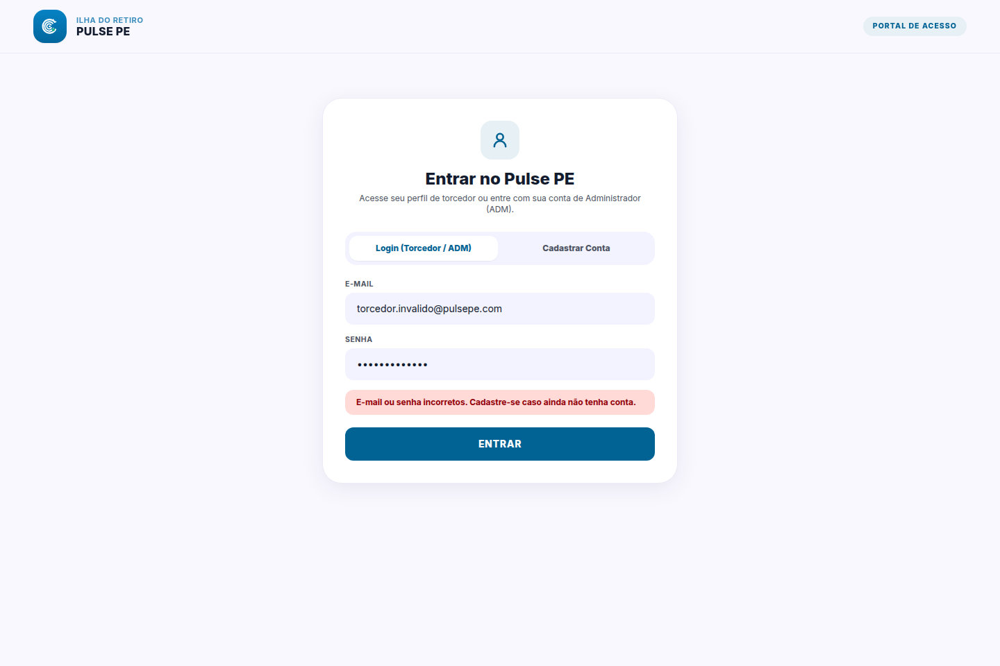

#### ✅ Caso Manual 01.B — Login do Torcedor com Credenciais Válidas (SUCESSO)
- **Pré-condição:** Conta previamente cadastrada com biometria homologada (`carlos.kaua@pulsepe.com`).
- **Dados inseridos no formulário:**
  - **E-mail:** `carlos.kaua@pulsepe.com`
  - **Senha:** `Pulse@2026`
- **Ação:** Clicar no botão **"Entrar"**.
- **Resultado Esperado:** Autenticar sessão, exibir mensagem de boas-vindas, liberar sino de notificações/avatar no topo e carregar tela principal de **Ingressos**.
- **Resultado Obtido:** Toast verde *"Bem-vindo(a), Carlos Kauã Santana!"*, saudação *"Olá, Carlos"* e selo *"BIOMETRIA VERIFICADA"* ativos (**Status: APROVADO**).

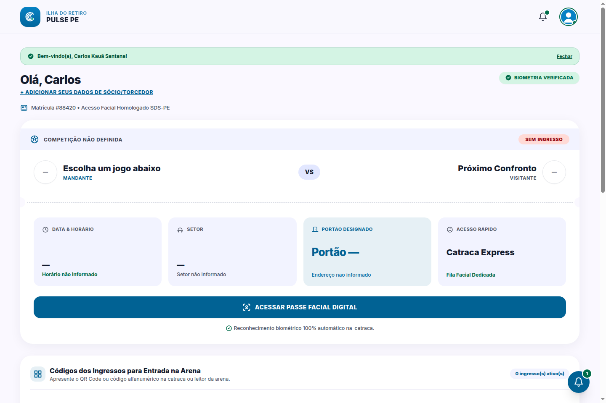

---

### Tela 02 — Formulário de Cadastro de Conta (`/` — Aba Cadastrar Conta)

#### ❌ Caso Manual 02.A — Cadastro com Dados Inválidos / CPF Incompleto (ERRO)
- **Pré-condição:** Acessar `http://localhost:3000/` e selecionar a aba **"Cadastrar Conta"**.
- **Dados inseridos no formulário:**
  - **Nome Completo:** `Carlos Kauã Santana` (também validado nome curto `"Jo"`)
  - **CPF:** `123.456` (incompleto — menos de 11 dígitos)
  - **E-mail:** `carlos@pulsepe.com`
  - **Senha:** `Pulse@2026`
- **Ação:** Clicar em **"Continuar para Reconhecimento Facial →"**.
- **Resultado Esperado:** Bloquear avanço para a etapa biométrica e destacar erro de validação do CPF.
- **Resultado Obtido:** Alerta exibido: *"Informe um CPF válido (11 dígitos)."* (**Status: APROVADO**).

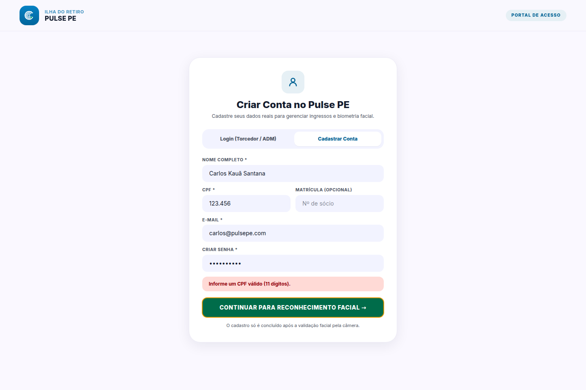

#### ✅ Caso Manual 02.B — Preenchimento Válido e Avanço para Etapa Biométrica (SUCESSO)
- **Pré-condição:** Aba **"Cadastrar Conta"** aberta.
- **Dados inseridos no formulário:**
  - **Nome Completo:** `Carlos Kauã Santana`
  - **CPF:** `123.456.789-01`
  - **Matrícula:** `88420`
  - **E-mail:** `carlos.kaua@pulsepe.com`
  - **Senha:** `Pulse@2026`
- **Ação:** Clicar em **"Continuar para Reconhecimento Facial →"**.
- **Resultado Esperado:** Validar dados cadastrais, iniciar câmera WebRTC e conduzir o usuário para a **Etapa 2 de 2 • Obrigatória (Biometria Facial)**.
- **Resultado Obtido:** Transição imediata para o módulo de captura facial com medidor de qualidade óptica em tempo real (**Status: APROVADO**).

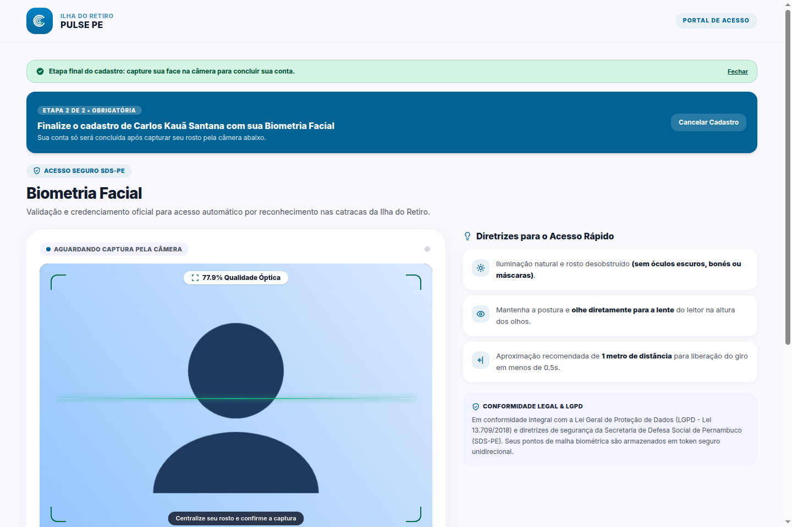

---

### Tela 03 — Captura e Validação de Biometria Facial SDS-PE (`/biometria`)

#### ❌ Caso Manual 03.A — Captura Facial Reprovada por Obstrução / Baixa Iluminação (ERRO)
- **Pré-condição:** Usuário na etapa de captura biométrica com câmera ativa.
- **Situação simulada:** Captura realizada com óculos escuros/boné e luminosidade insuficiente (`38%`).
- **Ação:** Clicar em **"Capturar e Validar Biometria"**.
- **Resultado Esperado:** Reprovar o credenciamento facial e listar os critérios exatos que falharam para correção pelo torcedor.
- **Resultado Obtido:** Painel vermelho *"✕ RECONHECIMENTO FACIAL REPROVADO — CORRIJA PARA VALIDAR"* detalhando *"Acessório detectado: remova óculos escuros ou boné"* e *"Iluminação abaixo do limiar mínimo exigido pela SDS-PE"*, com indicadores `✕ ILUMINACAO` e `✕ SEM OCULOS` (**Status: APROVADO**).

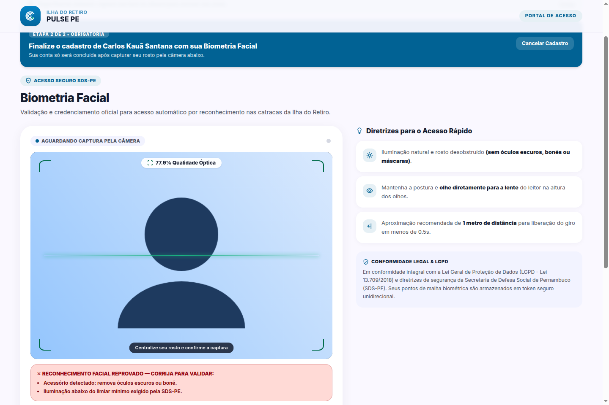

#### ✅ Caso Manual 03.B — Biometria Facial Homologada e Passe Facial Travado (SUCESSO)
- **Pré-condição:** Rosto centralizado, sem acessórios e iluminação adequada (`98.7%`).
- **Ação:** Clicar em **"Capturar e Validar Biometria"** e abrir **"Acessar Passe Facial Digital"**.
- **Resultado Esperado:** Gerar impressão digital facial única (`REC-884201`), travar a biometria contra adulterações (`TRAVADA`) e liberar o Passe Facial Digital para leitura nas catracas.
- **Resultado Obtido:** Biometria homologada com `Qualidade: 98.7%` e modal somente leitura exibindo token `REC-884201` (**Status: APROVADO**).

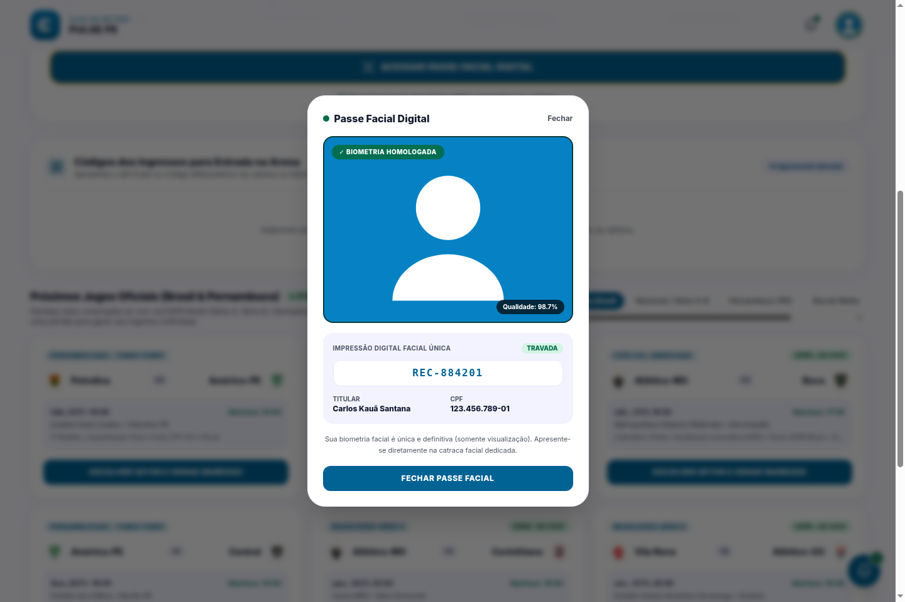

---

### Tela 04 — Emissão de Ingressos e Validação de Acesso na Arena (`/`)

#### ✅ Caso Manual 04.A — Escolha de Setor Oficial e Geração de Ingresso com QR Code (SUCESSO)
- **Pré-condição:** Torcedor autenticado na tela principal de **Ingressos**.
- **Passos executados:**
  1. Filtrar catálogo oficial por **"Ilha do Retiro"** (`Sport Recife x Náutico`).
  2. Clicar em **"Escolher Setor e Gerar Ingresso"**.
  3. Selecionar setor **"Sociais"** (`Portão 03 • Rua Sport Club do Recife`) e confirmar **"Gerar Ingresso com Passe Facial"**.
  4. Clicar em **"Abrir QR Code / Catraca"**.
- **Resultado Esperado:** Gerar bilhete único `PE-XXXXXX` vinculado ao CPF/biometria do titular e renderizar QR Code oficial ISO/IEC 18004 escaneável pela catraca.
- **Resultado Obtido:** Bilhete emitido e modal exibindo QR Code nítido, Portão 03, Setor Sociais e selo `Biometria OK` (**Status: APROVADO**).

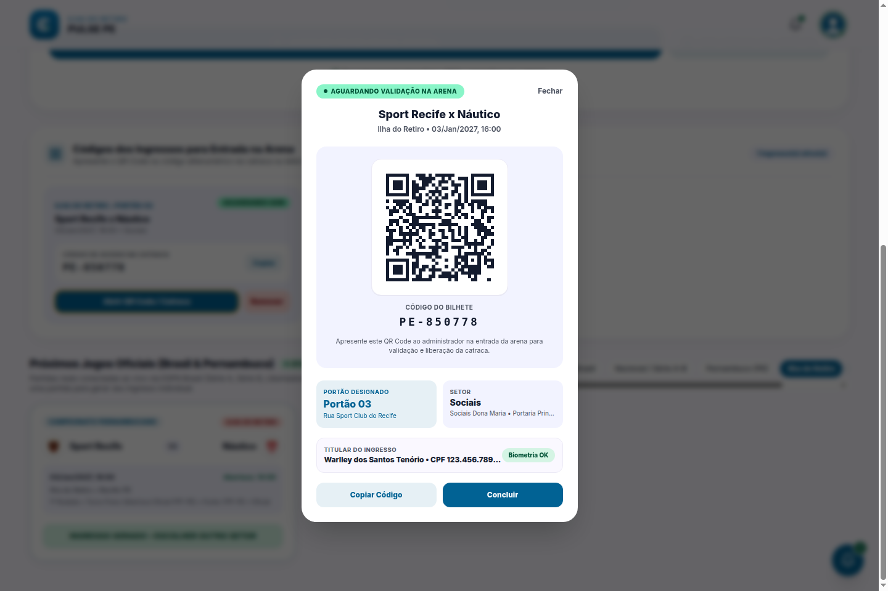

#### ❌ Caso Manual 04.B — Ingresso Reprovado pelo Administrador / Entrada Bloqueada (ERRO)
- **Pré-condição:** Torcedor possui ingresso `PE-416170` reprovado pela auditoria administrativa na catraca.
- **Ação:** Visualizar cartão principal de ingresso e clicar em **"VER MOTIVO ✕"**.
- **Resultado Esperado:** Exibir tarja vermelha de bloqueio na tela inicial, desabilitar o botão do passe facial (`ENTRADA BLOQUEADA NA CATRACA`) e ocultar o QR Code no modal exibindo o motivo da reprovação.
- **Resultado Obtido:** Modal exibe *"✕ ACESSO BLOQUEADO • REPROVADO — Entrada Não Autorizada. Motivo: Documento de identificação divergente do titular na catraca."* sem exibir QR Code (**Status: APROVADO**).

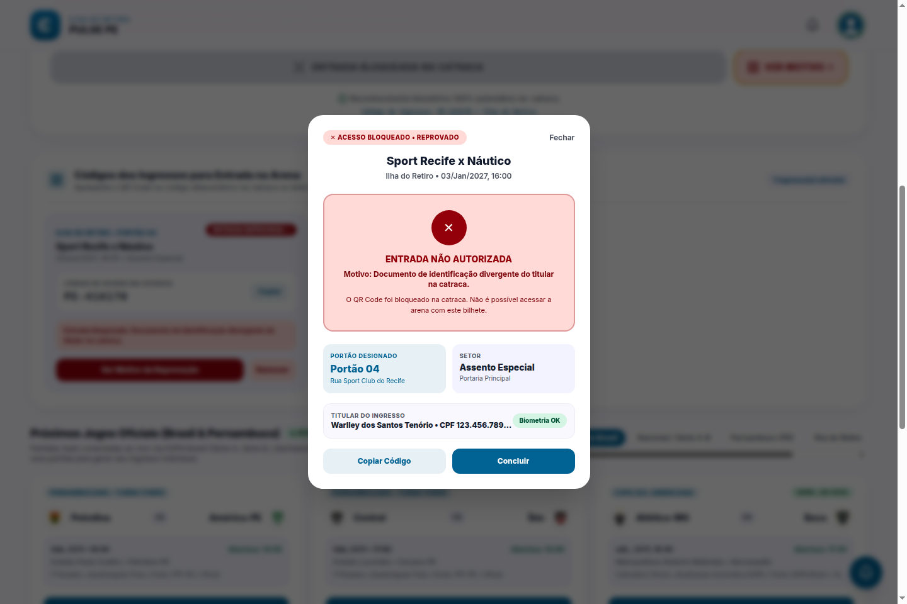

---

### Tela 05 — Dados Cadastrais do Perfil & Carteirinha Digital de Sócio

#### ❌ Caso Manual 05.A — Edição de Perfil com CPF Inválido (ERRO)
- **Pré-condição:** Clicar no ícone de perfil no canto superior direito → **"Acessar Dados do Perfil"**.
- **Dados inseridos no formulário:** Alterar o campo **CPF** para `123.45` (inválido) e clicar em **"Salvar Dados"**.
- **Resultado Esperado:** Impedir gravação incorreta e exibir erro no formulário modal.
- **Resultado Obtido:** Mensagem vermelha exibida: *"Informe um CPF válido (11 dígitos)."* mantendo o modal aberto para correção (**Status: APROVADO**).

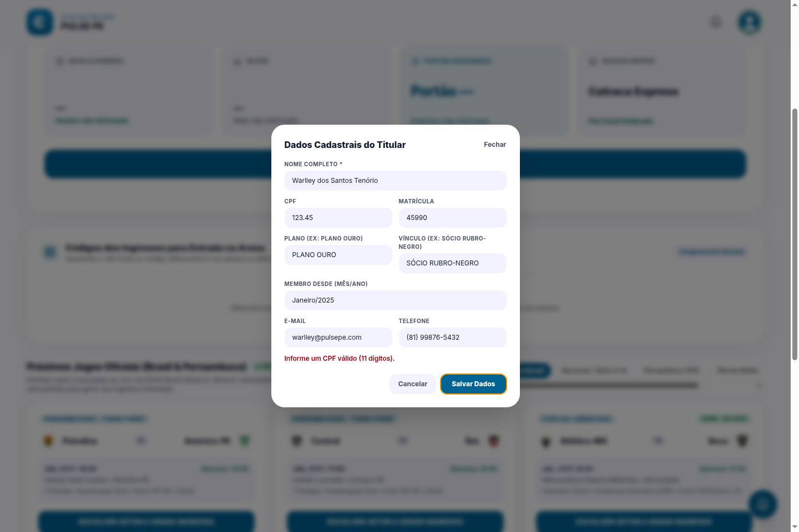

#### ✅ Caso Manual 05.B — Atualização Cadastral Válida e Emissão da Carteirinha Digital (SUCESSO)
- **Pré-condição:** Modal **"Dados Cadastrais do Titular"**.
- **Dados inseridos no formulário:** CPF `123.456.789-00`, Matrícula `45990`, Plano `PLANO OURO VIP`, Vínculo `SÓCIO RUBRO-NEGRO`, Telefone `(81) 99876-5432`.
- **Ação:** Salvar dados e abrir **"Menu do Usuário" → "Carteirinha Digital de Sócio"**.
- **Resultado Esperado:** Persistir os dados atualizados e renderizar credencial oficial do sócio com QR Code e status biométrico.
- **Resultado Obtido:** Credencial renderizada com selo *"PASSE OFICIAL DO SÓCIO"*, *"PLANO OURO VIP"*, *"BIOMETRIA HOMOLOGADA ✓"* e código `#45990` (**Status: APROVADO**).

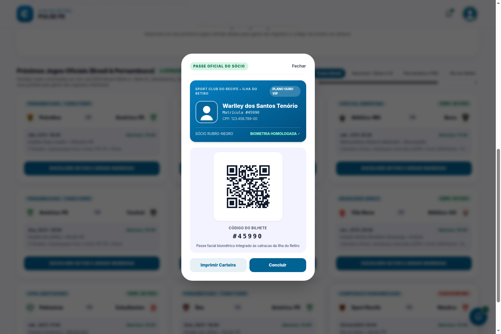

---

### Tela 06 — Portal Restrito de Login do Administrador (`/admin`)

#### ❌ Caso Manual 06.A — Tentativa de Acesso Não Autorizado ao Painel ADM (ERRO)
- **Pré-condição:** Acessar `http://localhost:3000/admin` (ou ser redirecionado automaticamente ao tentar abrir `/validar?codigo=PE-416170`).
- **Dados inseridos no formulário:**
  - **E-mail do Administrador:** `invasor@arena.com`
  - **Senha:** `SenhaIncorreta123`
- **Ação:** Clicar em **"Entrar no Painel ADM"**.
- **Resultado Esperado:** API `/api/admin/login` deve retornar `HTTP 401 Unauthorized` e bloquear acesso ao scanner e lista de bilhetes.
- **Resultado Obtido:** Alerta vermelho exibido: *"Credenciais inválidas. Acesso restrito ao administrador."* (**Status: APROVADO**).

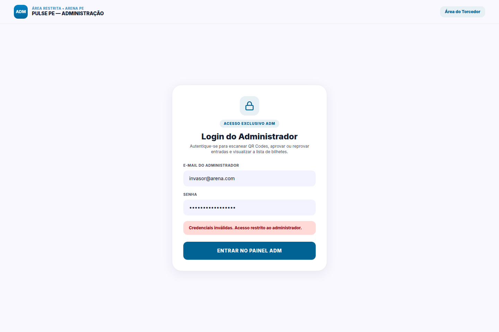

#### ✅ Caso Manual 06.B — Login Administrativo Oficial Homologado (SUCESSO)
- **Pré-condição:** Tela de Login do Administrador (`/admin`).
- **Dados inseridos no formulário:**
  - **E-mail do Administrador:** `admin@pulsepe.gov.br`
  - **Senha:** `PulsePE@2026`
- **Ação:** Clicar em **"Entrar no Painel ADM"**.
- **Resultado Esperado:** Gerar sessão assinada `HMAC-SHA256` via cookie `HttpOnly` e carregar o Painel Administrativo completo com indicadores KPI, leitor de QR Code e lista global de bilhetes.
- **Resultado Obtido:** Painel carregado exibindo `PULSE PE • ADM`, `Total de Bilhetes: 3`, `Aguardando Validação: 2`, `Entradas Aprovadas: 1` e listagem completa (**Status: APROVADO**).

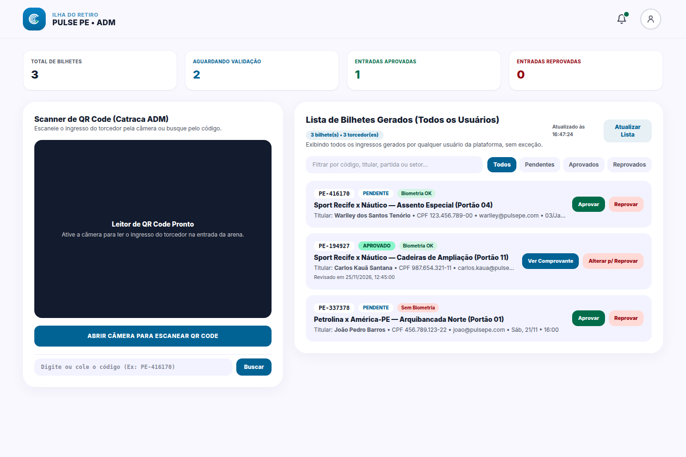

---

### Tela 07 — Scanner de Catraca e Auditoria de Bilhetes (`/admin` Autenticado)

#### ❌ Caso Manual 07.A — Consulta de Código de Bilhete Inexistente na Base (ERRO)
- **Pré-condição:** Operador autenticado no Painel Administrativo (`/admin`).
- **Dados inseridos no formulário:** Digitar código inexistente `PE-000999` no campo manual do Scanner e clicar em **"Buscar"**.
- **Resultado Esperado:** Informar imediatamente ao operador de catraca que o bilhete não consta na base oficial de emissões.
- **Resultado Obtido:** Banner de erro exibido: *"Bilhete PE-000999 não encontrado na base de ingressos gerados."* (**Status: APROVADO**).

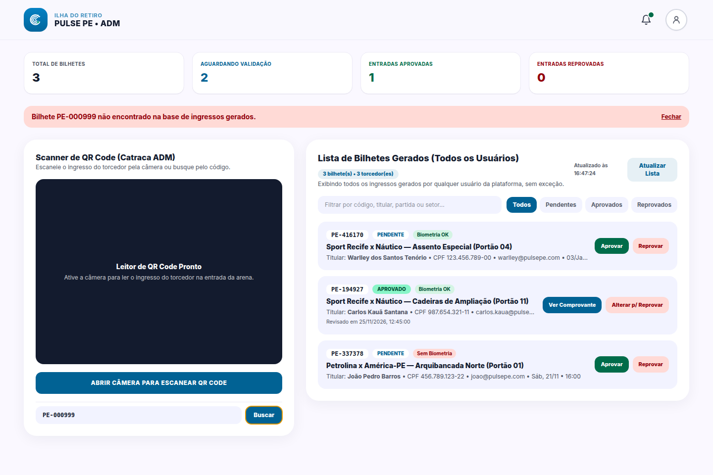

#### ✅ Caso Manual 07.B — Aprovação de Bilhete na Catraca e Emissão de Comprovante Oficial (SUCESSO)
- **Pré-condição:** Operador autenticado no Painel Administrativo (`/admin`).
- **Dados inseridos no formulário:** Buscar código válido `PE-416170` (`Warlley dos Santos Tenório`), clicar em **"✓ Aprovar Entrada"** e em seguida **"Ver Comprovante ✓"**.
- **Resultado Esperado:** Atualizar status do ingresso para `APROVADO`, registrar data/hora e e-mail do auditor responsável e emitir o comprovante oficial de liberação da catraca.
- **Resultado Obtido:** Modal *"COMPROVANTE DE ENTRADA LIBERADA"* exibido com `Status: AUTORIZADO A ENTRAR ✓`, dados completos do titular e assinatura `admin@pulsepe.gov.br` (**Status: APROVADO**).

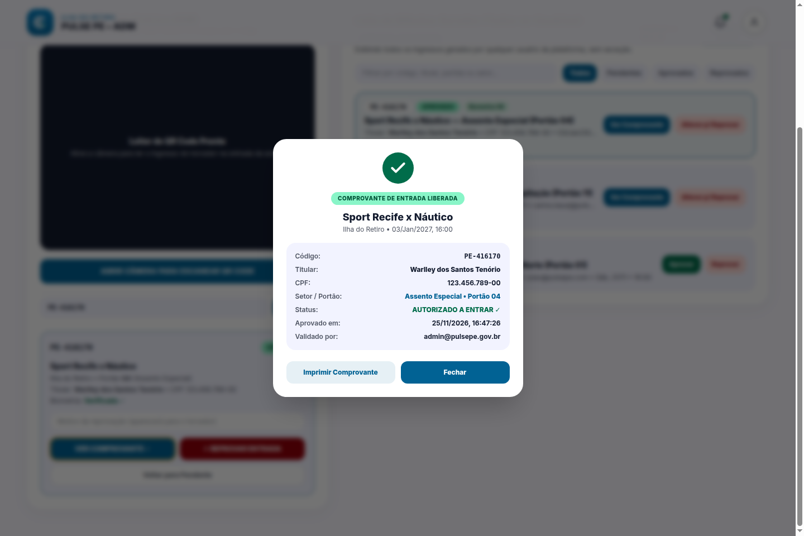

---

### Tela 08 — Central de Notificações e Publicação de Comunicados (`/?tab=notificacoes`)

#### ❌ Caso Manual 08.A — Tentativa de Publicação de Comunicado com Campos Obrigatórios Vazios (ERRO)
- **Pré-condição:** Acessar Central de Notificações e clicar em **"+ Adicionar"**.
- **Dados inseridos no formulário:** Deixar **Título da notificação \*** e **Mensagem da notificação \*** em branco.
- **Ação:** Clicar em **"Publicar"**.
- **Resultado Esperado:** Impedir submissão vazia exigindo preenchimento obrigatório do título e mensagem.
- **Resultado Obtido:** Submissão bloqueada pela validação de formulário com foco e alerta no campo obrigatório (**Status: APROVADO**).

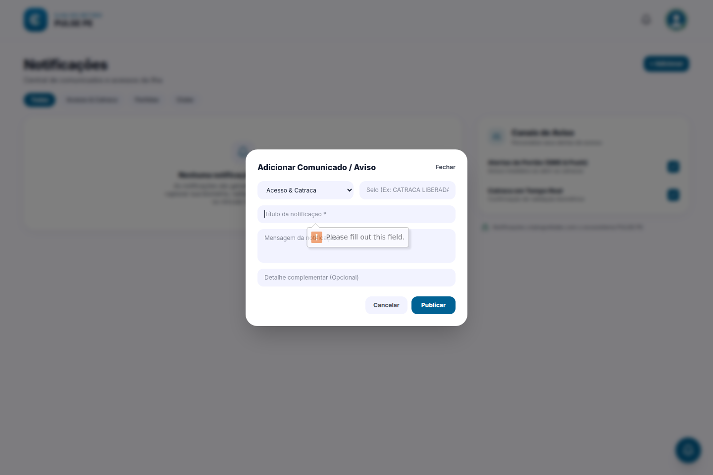

#### ✅ Caso Manual 08.B — Publicação de Comunicado Oficial de Abertura de Portões (SUCESSO)
- **Pré-condição:** Modal **"Adicionar Comunicado / Aviso"** aberto.
- **Dados inseridos no formulário:**
  - **Categoria:** `Acesso & Catraca`
  - **Selo:** `PORTÕES ABERTOS`
  - **Título:** `Portão 03 liberado para Sócios`
  - **Mensagem:** `Catracas biométricas expressas em operação normal na Ilha do Retiro.`
  - **Detalhe complementar:** `Ilha do Retiro • Setor Sociais`
- **Ação:** Clicar em **"Publicar"**.
- **Resultado Esperado:** Registrar alerta em tempo real, atualizar contador do sino/FAB e exibir card na central de avisos.
- **Resultado Obtido:** Toast verde *"Comunicado adicionado à central de notificações."* e card renderizado com selo `PORTÕES ABERTOS` (**Status: APROVADO**).

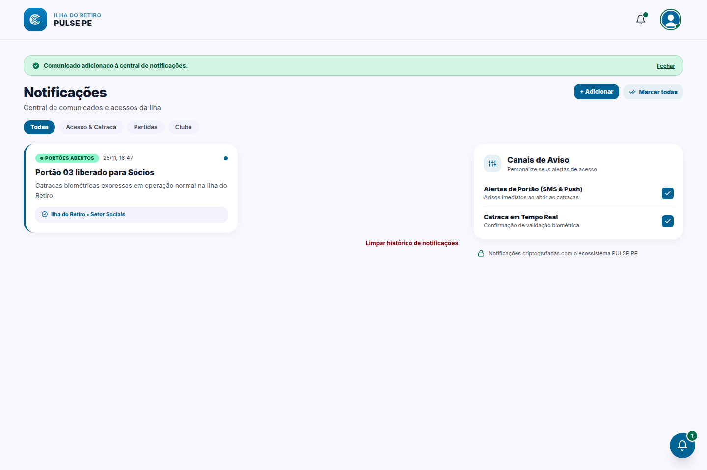

---

## 6. Registro de Defeito Identificado e Corrigido Durante os Testes

Durante a execução automatizada da suíte Cypress (`03-admin-catraca-auditoria.cy.ts`), a inspeção visual das evidências revelou uma melhoria importante que foi prontamente corrigida na branch:

- **Arquivo:** `app/admin/AdminPortalClient.tsx` (`handleReviewDecision`)
- **Causa:** Ao aprovar ou reprovar um bilhete via `POST /api/ingressos/validar` quando a API externa em nuvem estava em *cold start* ou offline, o cliente enviava apenas `{ codigo, decision, motivoReprovacao }`, omitindo os metadados do titular (`titular`, `cpf`, `jogo`, `estadio`, `setor`, `portao`, `dataHorario`, `biometriaOk`) que o endpoint já suportava via `fallbackMeta`.
- **Correção Aplicada:** Inclusão completa dos metadados do bilhete no payload da requisição, garantindo que o **Comprovante de Entrada Liberada** exiba sempre o nome completo, CPF, partida, setor e portão exatos do torcedor.

---

## 7. Como Executar Todos os Testes Localmente

Certifique-se de estar na branch `feat/automated-tests` com as dependências instaladas (`npm install`):

```bash
# 1. Rodar todos os 62 testes rápidos (Componentes + Unitários + Rotas de API)
npm test

# 2. Rodar camadas específicas no Vitest
npm run test:components   # Apenas testes de componentes React
npm run test:unit         # Apenas testes unitários (CPF, SHA-256, Auth, Storage)
npm run test:api          # Apenas testes de integração das APIs Next.js

# 3. Executar a suíte completa E2E no Cypress (compila build, sobe servidor e roda os 3 specs)
npm run test:e2e:ci

# 4. Abrir interface interativa visual do Cypress (com npm run dev ativo em outro terminal)
npm run cypress:open
```
